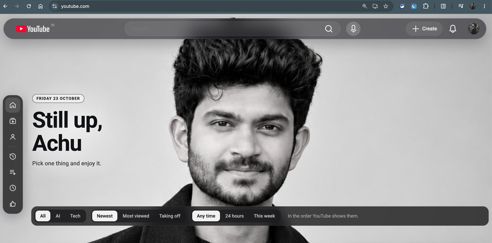

# ytTheme — calm YouTube

A Chrome extension (Manifest V3) that removes noise from YouTube and lets you
restyle it: a glass layout over your own wallpaper, a greeting, themes, and
tools to find what's worth watching. It runs only on `youtube.com`. Nothing is
paywalled.



## Features

**Cleanup.** Every item has its own switch:

- Hide Shorts, or open Shorts as normal videos.
- Hide feed ads, banners and merch, and skip video ads.
- Hide games (Playables and the Gaming chip), topic chips, and Mixes.
- Hide the home recommendations, the suggestions beside the player, end screens, and comments.
- Stop autoplay of the next video.
- Tidy the sidebar: hide Explore, More from YouTube and the footer.
- Show the dislike count (from [Return YouTube Dislike](https://returnyoutubedislike.com)) and a classic like/dislike ratio bar.

**Find what's worth watching.** A bar on Home, Subscriptions and channel Videos tabs:

- Topic: All, AI, Tech, or your own words.
- Sort: Newest, Most viewed, or Taking off (views per hour since upload).
- Time window: any time, the last 24 hours, or this week.

**Design:**

- **Glass layout.** A floating smoked-glass top bar and a small icon rail replace the full sidebar. Cards keep YouTube's own layout on a soft backing. An overlay-card style is optional.
- **Wallpapers.** Four illustrated scenes drawn as SVG, two gradients, or your own picture. Drag and zoom your picture to choose which part shows.
- **Readable text on any picture.** ytTheme measures how light your wallpaper is, separately behind the greeting. Text straight on the wallpaper switches to dark or light to match, and see-through chips get solid fills when needed.
- **Greeting.** Shows your name, with its colour taken from your wallpaper or one you choose.
- **Themes.** Six palettes or your own colours, plus a choice of fonts.
- **Mood.** A watch room that dims the page and lets the video's colours glow around the player, gentle motion, and soft synthesised click sounds.
- **In-page settings.** Press the ✦ button, then click any part of the page to open that part's settings.

**YouTube tools:**

- A one-click Not interested button on each video (Shift-click: Don't recommend channel).
- Hide a channel or a word from any video's ⋮ menu, and hide videos you've watched.
- Sidebar shortcuts to History, Playlists, Watch later and Liked.
- A search box on the History page, backed by a private list of the videos you open. The list stays in this browser.
- A cleaner player, and a suggestions column you can drag to resize.

## Install (unpacked)

1. Open `chrome://extensions`.
2. Turn on **Developer mode** (top right).
3. Click **Load unpacked** and choose this folder (the one with `manifest.json`).
4. Pin ytTheme from the puzzle-piece menu. The settings page opens on first install.

After pulling changes, click the reload icon on ytTheme's card in
`chrome://extensions`, then refresh any open YouTube tabs. Tabs that were open
during the reload keep the old version until refreshed.

## Privacy

Settings, hidden lists, your background picture and the History search list are
kept in `chrome.storage.local`. The only network request ytTheme makes is for
dislike counts, sent to `returnyoutubedislikeapi.com` with the video ID, and
only while that switch is on.

## Layout

```
manifest.json
src/background.js            service worker: first run, settings migrations, dislike counts
src/shared/wallpapers.js     the illustrated wallpapers (SVG)
src/shared/settings.js       defaults, themes, backgrounds, storage helpers
src/shared/ui.js             settings controls shared by popup, options, in-page panels
src/content/shared/          runtime (core.js), sounds + watch room, in-page panels, design layer
src/content/youtube/         cleanup, filters, sort bar, ⋮ menu, dislikes, sidebar, history, player, greeting, tokens
src/popup/  src/options/     toolbar popup and full settings page
```

How it works:

- `core.js` mirrors settings onto `<html>` as `data-lull-*` attributes and CSS variables, so the static stylesheets react instantly.
- Scripts handle what CSS can't, such as matching text, the ⋮ menu, ad skipping and sorting.
- `core.js` measures the wallpaper's brightness to set the text tone. For your own picture, it measures the part actually on screen.
- Themes remap YouTube's `--yt-spec-*` and `--yt-sys-color-baseline--*` tokens. YouTube also has hashed aliases (`--t…`) that hold fixed colours; `youtube/tokens.js` pairs each one with its readable token at load time.
